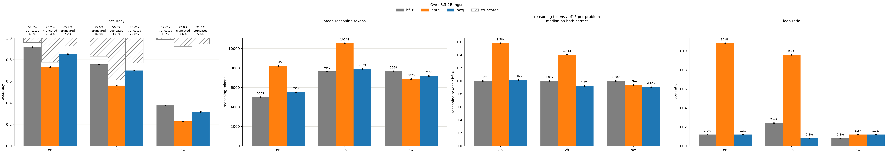
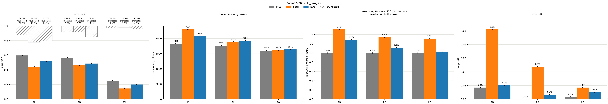

# multilingual quantization

## 배경

양자화가 영어보다 다른 언어를 더 해친다는 얘기를 들음. 찾아보니 다국어 양자화 연구는 대부분 손실을 재는 데서 그치고, qat로 회복하려는 연구는 많지 않았음. 그래서 먼저 정말 다른 언어를 더 해치는지 확인하고, 이전 프로젝트에서 본 반복과 길이 증가도 언어마다 어떻게 다른지 같이 본 뒤, 원인을 분석해 qat로 회복할 수 있는지 봄.

## 양자화가 다국어에서 특히 더 무너지는지

### 실험 설정

모델은 qwen3.5-2b thinking 모드. 양자화는 gptq, awq, weight-only 4비트, group size 128. awq는 num_grid 20, weight clip 적용. 오차는 그룹 출력 대신 편의상 layer 출력으로 비교.

calibration은 wikipedia 영어 128개, 2048토큰. 자체생성 reasoning은 대개 영어로 생각하기에, 이후 calibration 언어 통제를 위해 en, zh, sw를 지원하는 wikipedia 사용.

평가는 mgsm(각 250문제), mmlu-prox-lite(각 588문제)의 en, zh, sw. 프롬프트는 mgsm은 simple-evals, mmlu-prox-lite는 lm-evaluation-harness의 언어별 지시문 그대로 써서 지시문까지 해당 언어로 넣고, zero-shot. 샘플링은 qwen3.5 권장 설정 temperature 1.0, top-p 0.95, top-k 20, 최대 32768 토큰, seed 0. presence penalty 0에서 bf16 en이 66.8%, 잘린 출력이 28.8%로 반복이 많고 시간도 오래 걸려 권장 설정 1.5 사용. 채점은 \</think> 뒤에서 mgsm은 각 언어의 Answer: 뒤의 마지막 숫자, mmlu-prox-lite는 각 언어의 the answer is 뒤의 정답과 비교. 

반복은 reasoning 끝부분의 50글자가 그 앞에서 5번 이상 나오는 경우. 길이는 bf16과 양자화 모델이 둘 다 맞힌 문제에서 bf16 대비 문제별 reasoning 길이 비율의 중앙값으로 비교.

### 결과

gptq는 세 언어 모두 크게 떨어짐(en 91.6%→73.2%, zh 75.6%→56.0%, sw 37.6%→22.8%). awq는 비교적 적게 떨어짐(85.2%, 70.0%, 31.6%). 기대했던 것과 달리 양자화가 특히 영어 외 언어에서 성능이 크게 떨어지지는 않음.

gptq는 en, zh에서 반복과 길이 증가와 함께 옴(반복 1.2%→10.8%, 2.4%→9.6%). sw는 반복과 길이는 거의 그대로인데 정확도는 떨어짐. 끝까지 풀고 틀려서 떨어짐. awq는 세 언어 모두 반복과 길이가 비슷함.

비슷한 경향. gptq는 en 59.7%→44.2%, zh 56.6%→46.6%, sw 25.3%→14.6%, awq는 51.7%, 48.6%, 20.1%로 오히려 en이 가장 많이 떨어짐.

> 양자화가 특히 영어 외 언어를 해치지는 않음. 다만 gptq에서 en, zh는 반복과 길이 증가, sw는 그냥 틀리는 식으로 떨어짐.
